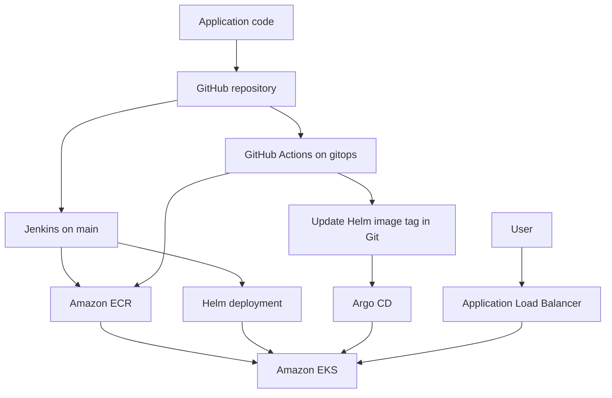

# Application Deployment with EKS, Jenkins, and GitOps

## Architecture



I built a containerized **Hello, World!** application and deployed it to Amazon EKS. I used Terraform to provision infrastructure, Jenkins to build and deploy the application, and a separate GitOps workflow with GitHub Actions and Argo CD.

The Jenkins deployment and the GitOps deployment are separate Helm releases. Jenkins manages `hello-app` in the `default` namespace; Argo CD manages `hello-gitops` in `gitops-demo`. The Jenkins deployment uses an Application Load Balancer for public access. I tested the GitOps deployment locally using port forwarding.

## Tools and services

| Tool or service | How I used it |
| --- | --- |
| Python and Flask | Served the Hello World application |
| Docker | Packaged the application as a container image |
| Terraform | Defined AWS infrastructure and IAM resources |
| Amazon ECR | Stored versioned container images |
| Amazon EKS | Ran and managed the Kubernetes workloads |
| Helm | Defined the application’s Kubernetes resources |
| Jenkins | Built, pushed, and deployed images from the main branch |
| GitHub Actions | Built and pushed images for the GitOps workflow |
| Argo CD | Synchronized the GitOps deployment with the repository |
| Metrics Server and HPA | Measured resource usage and scaled application replicas |
| Cluster Autoscaler | Adjusted worker-node capacity when workloads needed it |
| AWS Load Balancer Controller | Created the application load balancer from the Kubernetes ingress |

## 1. Create and containerize the application

I created a small Flask application that displays **Hello, World!**. I used a Dockerfile to package the application and its dependencies into a reproducible container image.

To build and run it locally from the repository root:

```powershell
docker build -t tech-challenge-2-app:local .
docker run --rm -p 5000:5000 tech-challenge-2-app:local
```

Open `http://localhost:5000` to test the application. Stop the container with Ctrl+C.

## 2. Provision AWS infrastructure

I used Terraform to define the AWS infrastructure, including a VPC, networking, IAM resources, an ECR repository, and the EKS cluster and managed node group. The lab used the `us-east-1` region and `t3.small` worker nodes.

I configured the Kubernetes tools to connect to the cluster and verified the worker nodes:

```powershell
aws eks update-kubeconfig --region us-east-1 --name tech-challenge-2-cluster
kubectl get nodes
```

Terraform state is local in this lab. Keep the state and any backups secure and do not commit them to Git.

## 3. Deploy with Helm and expose the application

I used the Helm chart in `helm/tech-challenge-2` to define the deployment, service, ingress, and autoscaling configuration. I installed the AWS Load Balancer Controller so the Kubernetes ingress could create an Application Load Balancer.

I verified the rollout and retrieved the ingress address:

```powershell
kubectl rollout status deployment/hello-app
kubectl get ingress hello-app
```

I opened the load balancer address in a browser and confirmed that the application displayed **Hello, World!** The lab used HTTP; production deployments should use TLS and appropriate network controls.

## 4. Automate deployment with Jenkins

I ran a Jenkins controller locally in Docker and connected a Windows inbound agent. The pipeline in `Jenkinsfile` checks out the private repository, creates a unique image tag, builds the Docker image, pushes it to ECR, and deploys it to EKS using Helm.

The pipeline stages are:

1. Check out the `main` branch.
2. Prepare a unique image tag.
3. Build the Docker image.
4. Push the image to ECR.
5. Deploy with Helm and wait for the Kubernetes rollout.

I configured Jenkins to poll the repository and verified a successful build triggered by a source-control change. The Jenkins agent used AWS credentials and a Kubernetes context configured on the Windows host.

## 5. Configure GitOps with GitHub Actions and Argo CD

I created a separate `gitops` branch and configured GitHub Actions to authenticate to AWS using OpenID Connect (OIDC). The workflow builds an image, pushes it to ECR, and commits the new image tag to `helm/tech-challenge-2/values-gitops.yaml`.

I connected the private repository to Argo CD and created the `hello-gitops` application with:

- **Revision:** `gitops`
- **Chart path:** `helm/tech-challenge-2`
- **Values file:** `values-gitops.yaml`
- **Destination namespace:** `gitops-demo`
- **Synchronization:** automatic

The GitOps values disable ingress for this separate release. I verified that a Git change led to a new image tag, an Argo CD sync, and a successful Kubernetes rollout:

```powershell
kubectl get deployment hello-gitops -n gitops-demo -o jsonpath="{.spec.template.spec.containers[0].image}"
kubectl rollout status deployment/hello-gitops -n gitops-demo
```

To test the GitOps service locally:

```powershell
kubectl port-forward -n gitops-demo service/hello-gitops 8083:80
```

Open `http://localhost:8083` and stop the port forward with Ctrl+C.

## 6. Test autoscaling

I installed Metrics Server and configured a Horizontal Pod Autoscaler (HPA) with 50% CPU and memory utilization targets. The application containers request `100m` CPU and `128Mi` memory, and their limits are `500m` CPU and `256Mi` memory. Each HPA was configured with a minimum of one and a maximum of twelve replicas.

I tested CPU-based scaling and observed the application scale out and then return to one replica. I also tested memory-based scaling on `hello-gitops`: the HPA increased from one to three replicas under load and returned to one after the load ended.

```powershell
kubectl get hpa -A
kubectl describe hpa hello-gitops -n gitops-demo
kubectl get pods -n gitops-demo -o wide
```

I also observed Cluster Autoscaler add worker-node capacity during scaling tests.

## 7. Verify the deployment

```powershell
kubectl get nodes
kubectl get pods -A -o wide
kubectl get hpa -A
kubectl rollout status deployment/hello-app
kubectl rollout status deployment/hello-gitops -n gitops-demo
```

I confirmed successful Jenkins and GitHub Actions runs, healthy Argo CD synchronization, successful rollouts, and the Hello World response in a browser.

## Screenshots

Project screenshots will be added throughout this README after they are uploaded to the repository.

## Cost and cleanup

EKS, EC2 worker nodes, the load balancer, public IPv4 addresses, storage, and ECR can incur AWS charges while resources exist. Review the AWS billing console and remove the lab resources when the live environment is no longer needed. Preserve the Terraform state until cleanup is complete, and verify that controller-created load balancers and other billable resources have been removed.
