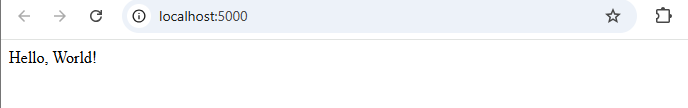
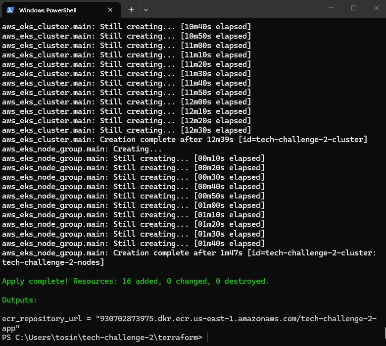
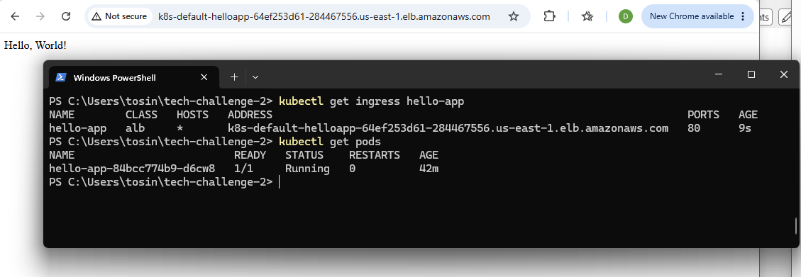
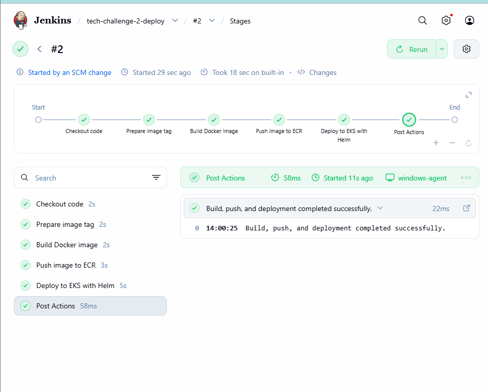
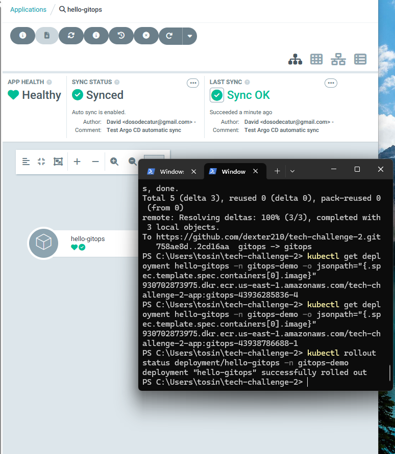
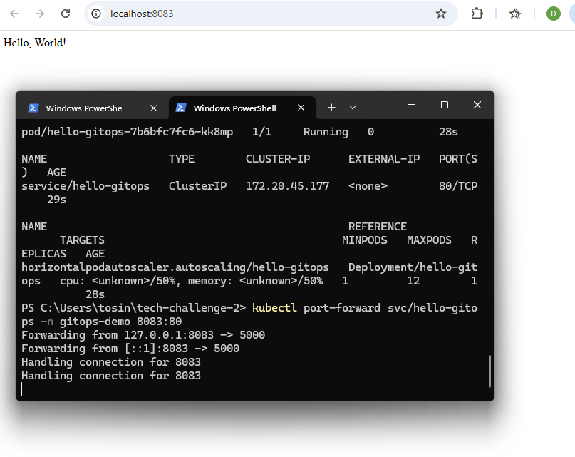
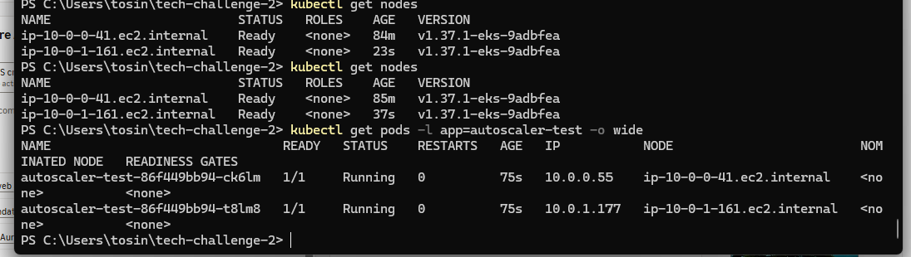
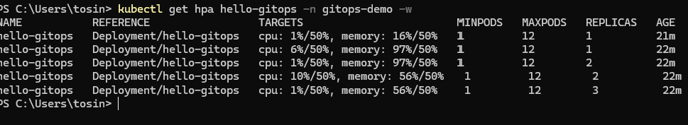

# AWS EKS Application Deployment | Terraform, Jenkins & GitOps

A hands-on deployment of a containerized Python/Flask application to **Amazon EKS**, with two independent CI/CD approaches: **Jenkins + Helm** and **GitHub Actions + Argo CD**.

**[Architecture](#architecture) · [Implementation](#implementation-results) · [Run locally](#run-locally) · [Terraform](terraform/) · [Helm](helm/tech-challenge-2/) · [Jenkins](Jenkinsfile) · [GitOps branch](../../tree/gitops) · [Screenshots](screenshots/)**

> **Deployment status:** This repository documents a successfully tested lab deployment, not an always-on hosted service. The application URL from the original lab is not advertised as a live endpoint. AWS resources may incur charges if you redeploy.

## Architecture


I built a containerized **Hello, World!** application and deployed it to Amazon EKS. I used Terraform to provision infrastructure, Jenkins to build and deploy the application, and a separate GitOps workflow with GitHub Actions and Argo CD.

The Jenkins deployment and the GitOps deployment are separate Helm releases. Jenkins manages `hello-app` in the `default` namespace; Argo CD manages `hello-gitops` in `gitops-demo`. The Jenkins deployment uses an Application Load Balancer for public access. I tested the GitOps deployment locally using port forwarding.

## Implementation results

- Provisioned an Amazon EKS cluster, VPC, IAM roles, an ECR registry, and managed worker nodes using Terraform.
- Deployed the Flask container to Kubernetes using Helm and confirmed access through an AWS Application Load Balancer.
- Executed a Jenkins pipeline that builds and pushes container images to ECR and rolls out updated application versions.
- Tested an independent GitOps path using GitHub Actions (OIDC), Argo CD, and an automatically synchronized Helm release.
- Verified CPU-based horizontal pod scaling, memory-driven scaling from **1 to 3 replicas**, and automatic worker-node capacity changes.

**Evidence:** [Terraform deployment](screenshots/15-terraform-apply-complete.png) · [ALB application response](screenshots/29-application-through-alb.png) · [Jenkins CI/CD](screenshots/55-automatic-jenkins-build.png) · [Argo CD sync](screenshots/68-argocd-automatic-sync.png) · [Autoscaling](screenshots/73-gitops-memory-autoscaling.png)

## Repository structure

| Path | Purpose |
| --- | --- |
| [`app.py`](app.py), [`requirements.txt`](requirements.txt), [`Dockerfile`](Dockerfile) | Flask application and container build |
| [`terraform/`](terraform/) | AWS networking, EKS, IAM, ECR, and cluster infrastructure |
| [`helm/tech-challenge-2/`](helm/tech-challenge-2/) | Kubernetes Deployment, Service, Ingress, and HPA |
| [`Jenkinsfile`](Jenkinsfile) | Jenkins image build, ECR push, and Helm rollout |
| [`gitops` branch](../../tree/gitops) | GitHub Actions pipeline, Argo CD configuration values, and GitOps-specific infrastructure |
| [`screenshots/`](screenshots/) | Deployment, pipeline, and scaling evidence |

## Tools and services

| Tool or service | How I used it |
| --- | --- |
| Python and Flask | Served the Hello World application |
| Docker | Packaged the application as a container image |
| Terraform | Defined AWS infrastructure and IAM resources |
| Amazon ECR | Stored versioned container images |
| Amazon EKS | Ran and managed the Kubernetes workloads |
| Helm | Defined the application’s Kubernetes resources |
| Jenkins | Built, pushed, and deployed images from the main branch |
| GitHub Actions | Built and pushed images for the GitOps workflow |
| Argo CD | Synchronized the GitOps deployment with the repository |
| Metrics Server and HPA | Measured resource usage and scaled application replicas |
| Cluster Autoscaler | Adjusted worker-node capacity when workloads needed it |
| AWS Load Balancer Controller | Created the application load balancer from the Kubernetes ingress |

## Prerequisites and reproducibility

To recreate the AWS deployment, you need an AWS account and CLI access, Terraform, Docker, `kubectl`, Helm, and an IAM principal authorized to provision networking, ECR, EKS, and related roles. Running a managed EKS cluster, worker nodes, and a load balancer **incurs AWS charges**.

1. Configure an AWS CLI profile and verify the account with `aws sts get-caller-identity`.
2. From `terraform/`, run `terraform init`, `terraform validate`, and `terraform plan -var="allowed_api_cidr=YOUR_PUBLIC_IP/32"`. Replace `YOUR_PUBLIC_IP` with your public IPv4 address to restrict EKS API access. Review the planned resources and costs before applying.
3. Apply the reviewed Terraform configuration with the same `allowed_api_cidr` value. Configure `kubectl` using the command below and verify worker-node readiness.
4. Build and publish a container image to the created ECR repository; configure Helm with that repository and image tag. Install the AWS Load Balancer Controller if using the public Ingress.
5. Run the Jenkins pipeline from a Jenkins agent with Docker, AWS CLI, Helm, and Kubernetes credentials, or deploy the image using Helm directly. The **GitOps workflow is separate** and is documented in the [`gitops` branch](../../tree/gitops).

> The source contains infrastructure and application configuration, but the README is **not** a turnkey, zero-configuration deployment script. The Jenkins controller, Argo CD connection, EKS add-ons, and local AWS credentials require environment-specific setup. Do not commit access keys, tokens, kubeconfig files, Terraform state, or secrets.

## Run locally

## 1. Create and containerize the application

I created a small Flask application that displays **Hello, World!**. I used a Dockerfile to package the application and its dependencies into a reproducible container image.

To build and run it locally from the repository root:

```powershell
docker build -t tech-challenge-2-app:local .
docker run --rm -p 5000:5000 tech-challenge-2-app:local
```

Open `http://localhost:5000` to test the application. Stop the container with Ctrl+C.



*I built the Docker image and ran the application locally.*

## 2. Provision AWS infrastructure

I used [Terraform configuration](terraform/) to define the AWS infrastructure, including a VPC, networking, IAM resources, an ECR repository, and the EKS cluster and managed node group. The lab used the `us-east-1` region and `t3.small` worker nodes.

I configured the Kubernetes tools to connect to the cluster and verified the worker nodes:

```powershell
aws eks update-kubeconfig --region us-east-1 --name tech-challenge-2-cluster
kubectl get nodes
```

Terraform state is local in this lab. Keep the state and any backups secure and do not commit them to Git. The example EKS worker nodes use public subnets for lab simplicity; a production architecture should use private worker-node subnets and stricter network controls.



*Terraform finished creating the infrastructure.*

## 3. Deploy with Helm and expose the application

I used the Helm chart in [`helm/tech-challenge-2`](helm/tech-challenge-2/) to define the deployment, service, ingress, and autoscaling configuration. I installed the AWS Load Balancer Controller so the Kubernetes ingress could create an Application Load Balancer.

I verified the rollout and retrieved the ingress address:

```powershell
kubectl rollout status deployment/hello-app
kubectl get ingress hello-app
```

I opened the load balancer address in a browser and confirmed that the application displayed **Hello, World!** The lab used HTTP; production deployments should use TLS, private worker nodes, and appropriate network controls.



*I verified the application through the Application Load Balancer.*

## 4. Automate deployment with Jenkins

I ran a Jenkins controller locally in Docker and connected a Windows inbound agent. The pipeline in [`Jenkinsfile`](Jenkinsfile) checks out the repository, creates a unique image tag, builds the Docker image, pushes it to ECR, and deploys it to EKS using Helm.

The pipeline stages are:

1. Check out the `main` branch.
2. Prepare a unique image tag.
3. Build the Docker image.
4. Push the image to ECR.
5. Deploy with Helm and wait for the Kubernetes rollout.

I configured Jenkins to poll the repository and verified a successful build triggered by a source-control change. The Jenkins agent used AWS credentials and a Kubernetes context configured on the Windows host.



*The Jenkins pipeline completed after a source-control change.*

## 5. Configure GitOps with GitHub Actions and Argo CD

I created a separate [`gitops` branch](../../tree/gitops) and configured [GitHub Actions](../../tree/gitops/.github/workflows/build-ecr.yml) to authenticate to AWS using OpenID Connect (OIDC). The workflow builds an image, pushes it to ECR, and commits the new image tag to `helm/tech-challenge-2/values-gitops.yaml`.

I connected the repository to Argo CD and created the `hello-gitops` application with:

- **Revision:** `gitops`
- **Chart path:** `helm/tech-challenge-2`
- **Values file:** `values-gitops.yaml`
- **Destination namespace:** `gitops-demo`
- **Synchronization:** automatic

The [GitOps values](../../blob/gitops/helm/tech-challenge-2/values-gitops.yaml) disable ingress for this separate release. I verified that a Git change led to a new image tag, an Argo CD sync, and a successful Kubernetes rollout:



*Argo CD synchronized the GitOps application.*

```powershell
kubectl get deployment hello-gitops -n gitops-demo -o jsonpath="{.spec.template.spec.containers[0].image}"
kubectl rollout status deployment/hello-gitops -n gitops-demo
```

To test the GitOps service locally:

```powershell
kubectl port-forward -n gitops-demo service/hello-gitops 8083:80
```

Open `http://localhost:8083` and stop the port forward with Ctrl+C.



*I confirmed the GitOps application responded through local port forwarding.*

## 6. Test autoscaling

I installed Metrics Server and configured a Horizontal Pod Autoscaler (HPA) with 50% CPU and memory utilization targets. The application containers request `100m` CPU and `128Mi` memory, and their limits are `500m` CPU and `256Mi` memory. Each HPA was configured with a minimum of one and a maximum of twelve replicas.

I tested CPU-based scaling and observed the application scale out and then return to one replica. I also tested memory-based scaling on `hello-gitops`: the HPA increased from one to three replicas under load and returned to one after the load ended.

```powershell
kubectl get hpa -A
kubectl describe hpa hello-gitops -n gitops-demo
kubectl get pods -n gitops-demo -o wide
```

I also observed Cluster Autoscaler add worker-node capacity during scaling tests.



*The Cluster Autoscaler added capacity during the test.*



*The HPA increased replicas after memory usage exceeded the target.*

## 7. Verify the deployment

```powershell
kubectl get nodes
kubectl get pods -A -o wide
kubectl get hpa -A
kubectl rollout status deployment/hello-app
kubectl rollout status deployment/hello-gitops -n gitops-demo
```

I confirmed successful Jenkins and GitHub Actions runs, healthy Argo CD synchronization, successful rollouts, and the Hello World response in a browser.

## Screenshots

Additional project screenshots are available in the [screenshots folder](screenshots/). Screenshots reflect testing at the time of the lab; they do not demonstrate currently running AWS resources.

## Cost and cleanup

EKS, EC2 worker nodes, the load balancer, public IPv4 addresses, storage, and ECR can incur AWS charges while resources exist. Review the AWS billing console and remove the lab resources when the live environment is no longer needed. Preserve the Terraform state until cleanup is complete, and verify that controller-created load balancers and other billable resources have been removed.
